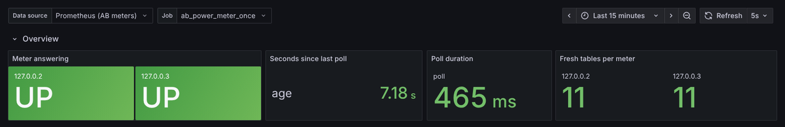

# AB Power Meters — Prometheus and Grafana

Live dashboards of the Allen‑Bradley site power meters: one row per meter
(IP address), one plot per unit with every parameter of that unit as a trace.
The meters are read by `ab_prometheus_exporter.py` 0.2.0, which uses the monitor
(`ab_power_meter_monitor.py` ≥ 1.6.2, 1.6.4 recommended) as a library and
**writes no files**.


## How the pieces fit

```
meters --HTTP--> ab_prometheus_exporter.py --+-- /metrics  <-- pull --  Prometheus --> Grafana
 (10.16.130.x)    (Python 3.7 or 3.12)        +-- push -->  Pushgateway <-- pull --'
                                              +-- JSON line per poll on stdout (--print-json)
```

| Mode | Command | Prometheus gets the data by | Use when |
|---|---|---|---|
| **Continuous** | `python ab_prometheus_exporter.py --ips … --interval 30` | scraping the exporter's `/metrics` (job `ab_power_meter`) | the exporter host is reachable from Prometheus; normal operation |
| Continuous, push | `… --push-gateway http://pushgw:9091 --no-http` | scraping the Pushgateway | Prometheus cannot reach the exporter host (firewall) |
| **Single run** | `python ab_prometheus_exporter.py --once --push-gateway http://pushgw:9091` | scraping the Pushgateway | cron / systemd timer / Windows Task Scheduler runs it on a schedule |
| Dict only | `… --once --print-json` or `--print-json` | — | another program reads the values from the pipe |

Every poll produces the same dict, from the command line (`--print-json`) or
from Python:

```python
import ab_prometheus_exporter as exp
snap = exp.poll_once(["10.16.130.50", "10.16.130.54"])          # single run
for snap in exp.iter_updates(["10.16.130.50"], interval=30):    # continuous
    volts = snap["by_unit"]["10.16.130.50"]["V"]                # one panel's traces
exp.start_server(["10.16.130.50"], port=9184)                   # also serve /metrics
```

`snap["meters"][ip]["tables"][table]["values"][parameter] = [value, unit]` and
`snap["by_unit"][ip][unit]["<table> / <parameter>"] = value` — `by_unit` is
exactly how the dashboard groups its traces.

## 1. Python environment (Python 3.7 host, RHEL 9)

RHEL 9's own `python3` is 3.9 and there is **no Python 3.7 package** for it,
so the 3.7 interpreter comes from conda‑forge (Miniforge / mamba). The
installer does all of it — environment under the install folder, pip upgrade,
wheels only (no compiler), service account, systemd units, SELinux labels:

```
sudo ./install.sh --mamba --py37 --only-exporter --ips 10.16.130.50,10.16.130.54 --open-port
sudo ./install.sh --mamba --py37 --only-exporter --ips 10.16.130.50,10.16.130.54 \
     --once-timer --push-gateway http://localhost:9091 --once-period 60    # single runs
```

By hand (any Linux with glibc ≥ 2.28):

```
mamba create -y -p /opt/abmeter/env -c conda-forge python=3.7.12 pip=24.0
/opt/abmeter/env/bin/python -m pip install --upgrade "pip<24.1"
/opt/abmeter/env/bin/python -m pip install --only-binary=:all: -r requirements-py37.txt
```

**Upgrade pip first.** The pip bundled with Python 3.7 (20.1) cannot read the
`manylinux_2_28` wheel tags (PySide6 6.5.3) and fails or falls back to
building from source; pip 24.0 is the last release for 3.7.
`prometheus_client==0.17.1` is the last release for 3.7 (0.18.0 has no 3.7
build).

Verified 2026‑10‑27 with exactly `requirements-py37.txt` on **Python 3.7.12**
(pip 24.0): requests 2.31.0, urllib3 2.0.7, beautifulsoup4 4.15.0, lxml 5.4.0,
psutil 7.2.2, prometheus_client 0.17.1, numpy 1.21.6, astropy 4.3.1, openpyxl
3.1.3, h5py 3.8.0, PySide6 6.5.3, matplotlib 3.5.3 — monitor, exporter,
dashboard and memory‑release test suites all pass; also with conda‑forge's
own 3.7 builds, and on **Python 3.12.3** (prometheus_client 0.26.0). The
exporter and the dashboard builder need only requests, beautifulsoup4, lxml,
psutil and prometheus_client.

### RHEL 9 specifics

| Topic | What to do |
|---|---|
| Python 3.7 | conda‑forge via Miniforge (`install.sh --mamba --py37`); never the system `python3` (3.9) |
| Environment location | under the install folder (`/opt/abmeter/env`), not in root's home: the `abmeter` service account must read it, and SELinux does not let services run programs from home folders |
| SELinux (enforcing) | `install.sh` labels `env/bin`, `venv/bin` and the wrapper `bin_t` (`semanage fcontext` + `restorecon`; `chcon` if `policycoreutils-python-utils` is missing). Check denials with `ausearch -m AVC -ts recent` |
| firewalld | Prometheus on another host must reach port 9184: `--open-port`, or `firewall-cmd --permanent --add-port=9184/tcp && firewall-cmd --reload`; 9091 (Pushgateway), 9090 (Prometheus), 3000 (Grafana) likewise when used remotely |
| systemd 252 | units verified with `systemd-analyze verify`; `StartLimitBurst` / `StartLimitIntervalSec` now in `[Unit]` (in `[Service]` the interval was ignored) |
| Prometheus, Pushgateway | not in the RHEL repositories: official release tarballs + `monitoring/systemd/prometheus.service`, `pushgateway.service` |
| Grafana | Grafana's RPM repository; provisioning in `/etc/grafana/provisioning/`, dashboards folder e.g. `/var/lib/grafana/dashboards/ab_power_meters` (owned by `grafana`) |
| Time | the plots use the exporter host's clock for fetch times — keep `chronyd` running |

## 2. Prometheus

Copy the two jobs of `monitoring/prometheus/prometheus.yml` into your
`prometheus.yml` (or use the file as it is), set the targets, then reload
Prometheus:

* `ab_power_meter` → `host:9184` of the continuous exporter;
  `scrape_interval` = the exporter's `--interval`.
* `pushgateway` → `host:9091`, with `honor_labels: true` so pushed data keeps
  `job="ab_power_meter"` and `instance=<host>`; needed only for single runs or
  `--push-gateway`.

Check it with `promtool check config prometheus.yml`. The Pushgateway is a
separate program from the Prometheus project (default port 9091).

## 3. Grafana

**Data source.** Copy `grafana/provisioning/datasources/ab_prometheus.yaml` to
Grafana's `conf/provisioning/datasources/` (Linux packages:
`/etc/grafana/provisioning/datasources/`), set `url` to your Prometheus and
restart Grafana. An existing Prometheus data source works as well — pick it in
the dashboard's *Data source* drop‑down.

**Dashboard — three ways:**

1. *Provisioning*: copy `grafana/provisioning/dashboards/ab_power_meters.yaml`
   to `conf/provisioning/dashboards/`, set its `path`, put the JSON file there.
   Grafana picks up changed files within 60 s.
2. *Import*: Dashboards → New → Import → upload the JSON file.
3. *HTTP API*: `ab_grafana_dashboard.py --grafana-url http://grafana:3000`
   with a service‑account token (Editor) in the environment variable
   `GRAFANA_TOKEN` (never on the command line).

**Which JSON.** `grafana/dashboards/ab_power_meters.json` works at once for any
meters: one row is repeated for every IP the exporter reports (variable
*Meter*). For fixed rows with friendly names, built from what the real meters
return, run on a host that can reach them:

```
python ab_grafana_dashboard.py --ips 10.16.130.50,10.16.130.54 ^
       --names "10.16.130.50=Maser building,10.16.130.54=Lab" ^
       --out monitoring/grafana/dashboards/ab_power_meters.json
```

(`^` continues a line in cmd; use `\` on Linux.) The builder polls the meters
once (headless, no files except the dashboard JSON) and makes one panel per
unit each meter actually reported. Other inventory sources:
`--from-prometheus http://prometheus:9090`, `--from-exporter
http://host:9184/metrics`, `--from-json line.json`.

## 4. Run it

| | Continuous | Single run |
|---|---|---|
| Linux / RHEL 9 | `sudo ./install.sh --mamba --py37 --only-exporter --ips …` installs and starts `ab-exporter.service` | `… --once-timer --push-gateway http://host:9091 --once-period 60` installs `ab-exporter-once.service` + `.timer` (templates in `monitoring/systemd/`) |
| Windows | `windows\ab_exporter_continuous.bat` | edit `windows\ab_exporter_once.bat`, then `schtasks /Create /TN "AB meters single poll" /SC MINUTE /MO 1 /TR "C:\ABMeter\monitoring\windows\ab_exporter_once.bat"` |

Exit codes of `--once`: 0 = at least one meter answered, 1 = none did,
2 = the push failed. Stop a continuous exporter with Ctrl+C, Ctrl+Break
(Windows), `systemctl stop` or `python ab_stop.py`.

## The dashboard

* **Overview**: *Meter answering* (UP / DOWN / STALE per IP), *Seconds since
  last poll*, *Poll duration*, *Fresh tables per meter*.
* **One row per meter**: a time‑series panel per unit — V, A, W, VAR, VA, %
  (power factor), Hz, kWh, kVARh, kVAh, s, min, ms — legend as a table with
  last / min / max / mean. Panels with more than six traces span the full width
  with the legend on the right. Values without a unit (configuration numbers,
  status words, counters) are a table at the end of the row.
* Variables: *Data source*, *Job* (`ab_power_meter` by default; a second job
  name lets pulled and pushed data be viewed separately) and, in the repeat
  layout, *Meter*.

A Pushgateway keeps the last pushed values until the next push, so after the
single runs stop the plots would continue flat. *Meter answering* therefore
shows **DOWN / STALE** when the last poll is older than
$t_\text{stale} = 3\,T$ ($T$ = poll or schedule period, `--interval`; change
with `--stale-after`), and *Seconds since last poll* turns orange after
$2.5\,T$ and red after $10\,T$.



## No files are written

The exporter starts none of the monitor's writers (CSV, Markdown, FITS, XLSX,
`.vszh5`), no log file (log lines go to stderr, the JSON to stdout), no
pickle, and no `__pycache__` (`sys.dont_write_bytecode`). The test
`test_once_cli_json_exit_codes_no_files` compares the program and working
folders before and after a run. The only file the dashboard builder writes is
the dashboard JSON (`--out ""` with `--grafana-url` writes none).

## Verified (2026‑10‑27)

Emulated meters → exporter → Prometheus 3.5.0 + Pushgateway 1.11.1 → Grafana
12.2.0 (official release binaries, checksums verified), the exporter on
Python 3.7.12 throughout:

* continuous run: 274 polls at 5 s, one JSON line each, `/metrics` scraped
  every 5 s, no warning or error logged;
* single runs: 68 `--once --push-gateway` runs, all exit code 0, pushed group
  `job=ab_power_meter_once, instance=e2e-host`;
* the per‑meter, repeat and API‑uploaded dashboards rendered in headless
  Chromium with every panel showing data and no browser errors;
* unit tests on Python 3.7.12 (pip, `requirements-py37.txt`), 3.7.12
  (conda‑forge) and 3.12.3: `tests/test_exporter_offline.py` (9 checks),
  `tests/test_grafana_dashboard.py` (4), plus the monitor suites; all nine
  suites of `tests/run_all_tests.py --quick` on 3.12;
* `install.sh --mamba --py37 --only-exporter --once-timer` run end to end
  (micromamba standing in for mamba, `systemctl` stubbed): Python 3.7.12 env
  in the prefix, pip 24.0, every pin installed as a wheel, units rendered;
  the rendered `ExecStart` pushed to the Pushgateway; all units pass
  `systemd-analyze verify`.

**Not verified here:** an actual RHEL 9 machine. The tests ran on Ubuntu 24.04
(glibc 2.39; RHEL 9 has 2.34, above the 2.28 the wheels need), so the SELinux
and firewalld branches of `install.sh` and the systemd units under a real
systemd were not exercised. A first install on the RHEL 9 host should be
checked with `systemctl status`, `journalctl -u ab-exporter*` and
`ausearch -m AVC -ts recent`.

## Troubleshooting

| Symptom | Fix |
|---|---|
| Panels say *No data*, Overview works | wrong *Job* selected, or the dashboard was built for other IPs — rebuild or use the repeat JSON |
| Repeated rows empty (custom dashboards) | match a multi-value variable with `ip=~"$ip"`: Grafana regex-escapes it for Prometheus |
| Pushed values never change | the single runs stopped; *Meter answering* shows STALE; check the timer / task |
| Duplicate traces | pulled and pushed data under the same job — give one of them another `--push-job` |
| `400` from the Pushgateway | do not combine pushes with `--timestamps` (the exporter never does) |
| `prometheus_client` missing on Python 3.7 | `pip install prometheus_client==0.17.1` |
| pip on 3.7: *No matching distribution found for PySide6==6.5.3* | `python -m pip install --upgrade "pip<24.1"` first |
| Service fails with *Permission denied* (RHEL) | SELinux: `ausearch -m AVC -ts recent`; label the env `bin_t` (install.sh does) |
| Prometheus target *down* from another host | firewalld: open 9184/tcp (`install.sh --open-port`) |

## References

| # | Reference (IEEE) |
|---|---|
| [1] | Prometheus Authors, "Writing exporters," *Prometheus documentation*. [Online]. Available: https://prometheus.io/docs/instrumenting/writing_exporters/ |
| [2] | Prometheus Authors, "When to use the Pushgateway," *Prometheus documentation*. [Online]. Available: https://prometheus.io/docs/practices/pushing/ |
| [3] | Prometheus Authors, "Exporting to a Pushgateway," *prometheus_client documentation*. [Online]. Available: https://prometheus.github.io/client_python/exporting/pushgateway/ |
| [4] | Prometheus Authors, "Configuration — scrape_config (honor_labels)," *Prometheus documentation*. [Online]. Available: https://prometheus.io/docs/prometheus/latest/configuration/configuration/ |
| [5] | Grafana Labs, "Provision Grafana," *Grafana documentation*. [Online]. Available: https://grafana.com/docs/grafana/latest/administration/provisioning/ |
| [6] | Grafana Labs, "Dashboard HTTP API," *Grafana documentation*. [Online]. Available: https://grafana.com/docs/grafana/latest/developers/http_api/dashboard/ |
| [7] | Grafana Labs, "Variables," *Grafana documentation*. [Online]. Available: https://grafana.com/docs/grafana/latest/dashboards/variables/ |
| [8] | Grafana Labs, "JSON model," *Grafana documentation*. [Online]. Available: https://grafana.com/docs/grafana/latest/dashboards/build-dashboards/view-dashboard-json-model/ |
