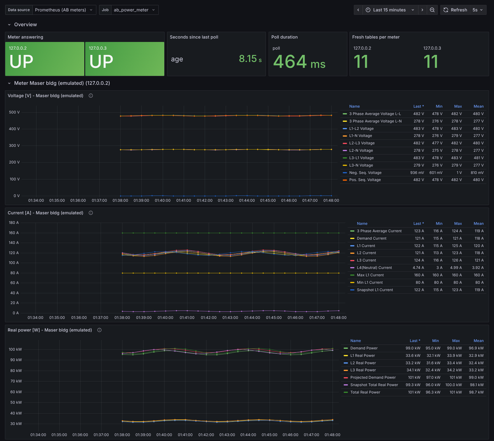

# AB Power Meter Monitor — Deployment & Integration Guide

Allen‑Bradley (Rockwell 1403) site power‑meter poller, data logger, GUI and
Prometheus exporter for NRAO / Green Bank Observatory site infrastructure
monitoring. **Release 1.7.0 (2026‑10‑27)** — Python 3.12 primary target (Linux and Windows).

The toolset polls AB power meters over HTTP (each meter strictly one page at a
time, meters in parallel), parses the 11 HTML table pages, keeps a columnar
time series in memory, and writes any combination of CSV, Markdown, **native
Veusz `.vszh5` (appended in place)**, FITS and XLSX — or serves the live values
to Prometheus. The GUI shows **interactive plots** (pyqtgraph): one tab per
meter, crosshair read‑out, zoom and pan while the data update. A full manual (LuaLaTeX source and bookmarked PDF) ships in
`docs/`.

---

## Contents

- [What changed in 1.7.0](#what-changed-in-170)
- [What changed in 1.6.5](#what-changed-in-165)
- [What changed in 1.6.4](#what-changed-in-164)
- [What changed in 1.6.3](#what-changed-in-163)
- [What changed in 1.6.2](#what-changed-in-162)
- [What changed in 1.6.1](#what-changed-in-161)
- [What changed in 1.6.0](#what-changed-in-160)
- [Components & versions](#components--versions)
- [Deployment modes](#deployment-modes)
- [Requirements & environment setup](#requirements--environment-setup)
- [Configuration switches](#configuration-switches)
- [Memory protection (RAM flush)](#memory-protection-ram-flush)
- [Outputs and persistence](#outputs-and-persistence)
- [Veusz `.vszh5` output](#veusz-vszh5-output)
- [Mode A — headless monitor under systemd](#mode-a--headless-monitor-under-systemd)
- [Mode B — Prometheus exporter](#mode-b--prometheus-exporter)
- [Grafana dashboard](#grafana-dashboard)
- [Mode C — driving the monitor from Python](#mode-c--driving-the-monitor-from-python)
- [GUI](#gui)
- [Graceful stop](#graceful-stop)
- [Testing offline](#testing-offline)
- [Windows test kit](#windows-test-kit)
- [Python version compatibility](#python-version-compatibility)
- [Restart behaviour & log access](#restart-behaviour--log-access)
- [Uninstall](#uninstall)
- [Troubleshooting](#troubleshooting)
- [Change log](#change-log)

---

## What changed in 1.7.0

The GUI's picture previews (matplotlib, one re‑rendered PNG per tab) are
replaced by **interactive pyqtgraph plots** drawn by the new companion module
`ab_live_plots.py` (keep it next to the monitor, like `vszh5_writer.py`).


| Area | 1.6.x | 1.7.0 |
|---|---|---|
| Tabs | one per table and per overlay group (~40 for two meters) | **one per meter** |
| Plots | one picture per tab | one plot per **unit** (V, A, W, VAR, VA, %, Hz, kWh, …), or per table, or per overlay group (View box) |
| Reading values | none in the tab (separate frozen window) | **crosshair** in every plot of the meter; a **legend column** beside each plot lists every trace's value at the cursor and its newest value |
| Zoom / pan | separate snapshot window | in place, **while it updates**: drag = pan, right‑drag = zoom one axis, **Ctrl + wheel** = zoom (the plain wheel scrolls the tab), "A" = auto range; right‑click menu exports CSV / PNG / SVG |
| Time window | all data | **Follow newest** with *Show* presets 10 min … 7 d / all; any manual zoom stops following, so a poll never moves the view |
| Identity | — | per meter: polled address, the **address the meter reports** (red when different), serial number, rows in memory, answered / no answer in the last poll |
| Outages | straight line across | drawn as **gaps** (`LIVE_PLOT_GAP_FACTOR`) |
| Memory | a PNG of the visible tab | curves made once and updated in place; only the visible meter tab reads the store; hidden tabs drop their arrays (`LIVE_PLOT_RELEASE_HIDDEN`); traces min/max‑decimated to `LIVE_PLOT_MAX_POINTS` |
| Fallback | — | `PREVIEW_BACKEND = "matplotlib"`, a missing pyqtgraph, or one that fails the start‑up check give the 1.6 picture previews (WARNING in the console) |

**Dependencies:** + `pyqtgraph` (0.14.0 on Python 3.12, tested; 0.13.3 on 3.8).
Python 3.7: pyqtgraph 0.12.4 works only with **PySide6 ≤ 6.2.4**, so
`requirements-py37.txt` now pins PySide6 6.2.4 (was 6.5.3). With 6.5.3 the
monitor still starts and falls back to pictures by itself. In an existing
mamba environment: `mamba install -c conda-forge pyqtgraph`.

**Measured** (`tests/live_plot_memory_check.py`, one emulated meter, 44 traces,
Python 3.12.3 / 3.7.12):

| rows per table | store (MB) | plot update after a poll (s) | plot arrays (MB) | after the tab is hidden (MB) |
|---:|---:|---:|---:|---:|
| 1,000 | 3.4 | 0.03 / 0.02 | 2.7 | 2.2 |
| 10,000 | 33.7 | 0.06 / 0.05 | 6.4 | 2.2 |
| 50,000 | 168.6 | 0.30 / 0.25 | 9.0 | 2.2 |

**Fixed on the way:** with PySide6 6.2 every deleted pyqtgraph plot left its
11 right‑click menus behind (351 per view change) — now deleted with the plot;
a hidden tab kept pyqtgraph's display arrays (6.9 MB at 50 000 rows) — now
`PlotDataItem.clear()`; dark theme check boxes were invisible when unticked.

**Tests:** new `tests/test_live_plots.py` (8 checks: every drawn value and
every crosshair read‑out equals the stored value of *that* meter, legend,
Ctrl+wheel/scroll, follow, no widget leak, release, both fallbacks) passes on
Python 3.12.3 (PySide6 6.12.0 and 6.11.2, pyqtgraph 0.14.0), 3.8.20 (PySide6
6.6.3.1, pyqtgraph 0.13.3) and 3.7.12 (PySide6 6.2.4, pyqtgraph 0.12.4). GUI
soak 0.0.3: widget growth 0 (60–90 s on 3.12 and 3.7; 10 min on 3.12, RSS
flat after ~200 polls). **`tests/run_all_tests.py --quick`: 11/11 suites pass
on Python 3.12.3 and on 3.7.12** (Linux). The runner caught one more defect:
under its warnings‑as‑errors rule a deprecated PySide6 call made the start‑up
check fail and the GUI fall back silently — fixed, and the GUI soak now fails
if pyqtgraph is installed but not used. On 3.7 the runner had reported every
package as missing (no `importlib.metadata`) and skipped the GUI soak — fixed.

## What changed in 1.6.5

Triggered by the report that the GUI plots of the two real meters looked
alike. Staged follow-up work: [`docs/plans/PLAN_1.7.0_pyqtgraph_and_meter_check.md`](docs/plans/PLAN_1.7.0_pyqtgraph_and_meter_check.md).

| Area | Result |
|---|---|
| Data path audit | fetch (pages serial per meter, meters parallel), parse, store, CSV, Markdown, `.vszh5`, FITS, XLSX, GUI preview and exporter are all keyed by the polled IP — verified by `tests/test_ip_separation.py` on Python 3.12.3 and 3.7.12 |
| Test blind spot | the emulator served the same values to every host, so a mix‑up was undetectable; emulator 0.0.2 makes hosts distinguishable (scale, own IP, serial) |
| Identity check | a meter that reports another IP address than the one polled is warned about; poll meta `reported_ips` |
| `ab_check_meters.py` | run against the real meters or the CSV output: SAME SOURCE / WRONG ADDRESS / NEARLY EQUAL / DIFFERENT |
| Interactive plots | pyqtgraph prototype (crosshair read‑out, zoom, pan, follow newest) — integrated in 1.7.0 |

## What changed in 1.6.4

Prometheus / Grafana operation, Python 3.7 on RHEL 9 (monitor 1.6.4, exporter
0.2.0, dashboard builder 0.0.1, install.sh 1.2.0). Set‑up guide:
[`monitoring/README_monitoring.md`](monitoring/README_monitoring.md) (+ PDF).

| Area | Before | Now |
|---|---|---|
| Exporter modes | continuous pull only | **continuous** (pull, and/or push after every poll, `--count`) or **single run** `--once` (push to a Pushgateway, exit code 0/1/2); `--print-json` writes the dict as one JSON line per poll; Python API `poll_once()`, `iter_updates()`, `run(on_update=…)`, `snapshot()` |
| Files | — | the exporter writes **no files** (no outputs, no log file, no `__pycache__`), checked by test |
| Grafana | no dashboard | `ab_grafana_dashboard.py`: Overview row + one row per meter (IP), one time‑series panel per unit with every parameter of that unit as a trace, unit‑less values as a table; per‑meter or repeated rows; JSON file, provisioning or HTTP API upload. Verified with Grafana 12.2, Prometheus 3.5, Pushgateway 1.11 |
| Units | "kVA Hour Net" had no unit | `kVAh` (monitor 1.6.4) |
| Python 3.7 | pins syntax‑checked | verified on 3.7.12: every `requirements-py37.txt` pin installs as a wheel **after upgrading pip to 24.0** (3.7's own pip cannot read `manylinux_2_28` tags); monitor, exporter and dashboard tests pass |
| RHEL 9 | — | no Python 3.7 package there: `install.sh --mamba --py37` builds the env in `/opt/abmeter/env` (was root's home: unreadable for the service user, blocked by SELinux), labels it `bin_t`, opens the port in firewalld (`--open-port`), installs the single‑run timer (`--once-timer`) |
| systemd | `StartLimitIntervalSec` in `[Service]` (ignored by systemd ≥ 230) | in `[Unit]`; all units pass `systemd-analyze verify` |

## What changed in 1.6.3

First test on real Windows (txrx03: Windows 11 26H2, Intel i9, 32 GB).

| Area | 1.6.2 | 1.6.3 |
|---|---|---|
| GUI on Windows (conda‑forge env) | closed with exit code `-1066598273` = `0xC06D007F` (Visual C++ delay‑load "procedure not found") at the first preview plot | cause: Intel oneMKL **2026.1.0**, conda‑forge's default BLAS for NumPy on Windows, crashed inside `np.dot` (matplotlib's 3×3 transforms) on that CPU; not in this program. The Windows kit pins **OpenBLAS** (`libblas=*=*openblas`); confirmed on txrx03 (80 polls, all outputs, no warning). The headless monitor never multiplies matrices and was never affected. |
| BLAS threads | library default (one per CPU thread) | `OPENBLAS_NUM_THREADS=1` set before NumPy loads (`BLAS_MAX_THREADS`; a value already set is kept). OpenBLAS's per‑thread buffers were **2,971 MB** of commit charge, **18 MB** with one thread (measured on txrx03). |
| Offline meter | every page retried: ~67 s and 44 warnings per poll (defaults) | once a meter refuses the connection / cannot be reached, its other pages are skipped for that poll (`SKIP_PAGES_WHEN_UNREACHABLE = 1`); an HTTP error on a page that connected does not count |
| Run with no data | final writes reported `up to date` | `no data received`; `run_status()` adds `polls_with_data` |
| Windows kit | fixed 3 s wait for the emulator (first poll could be refused) | waits until the emulator answers (`tests/wait_for_port.py`); PowerShell/cmd notes in `START_HERE` |

**Your own conda environments on Windows:** if `numpy.show_config()` and
`mamba list "blas|mkl"` show `libblas … mkl` with `mkl 2026.1.0`, switch to
OpenBLAS: `mamba install -n <env> -c conda-forge "libblas=*=*openblas"`.

## What changed in 1.6.2

| Area | 1.6.1 | 1.6.2 |
|---|---|---|
| CSV / Markdown file **open in Excel** (Windows) | Excel blocks writes to an open file; the monitor logged an ERROR for every table on every poll, and a flush could not drop those rows while the file stayed open | one WARNING per file per 10 min; rows stay in memory and are written when the file is closed; a flush / Save Now / stop writes them to `<file>_<stamp>_rescue.csv` / `.md`, merged back in order on the next write (as FITS, XLSX and `.vszh5` already did) |
| Stopping on Windows | Ctrl+Break (`CTRL_BREAK_EVENT`) killed the headless monitor and the exporter without the final writes | handled like Ctrl+C / SIGTERM: graceful stop with the final writes (monitor 1.6.2, exporter 0.1.1) |
| Windows testing | — | `windows/` test kit: one-click setup, all suites, Task Manager check, GUI and headless checklists, results zip ([below](#windows-test-kit)) |

## What changed in 1.6.1

| Area | 1.6.0 | 1.6.1 |
|---|---|---|
| RAM flush on **Windows** | rows were dropped, but only `gc.collect()` ran: the process kept the freed memory and Task Manager showed no drop | after every flush `return_memory_to_os()` decommits free heap memory (`HeapSetInformation(NULL, HeapOptimizeResources)`) and trims the working set (`EmptyWorkingSet`), so Task Manager's **Memory** column drops at once |
| Duplicate‑row race | a flush / Save Now / stop that waited for a busy writer could read its cursor before it advanced and send the same rows again (seen as extra XLSX rows on Windows Python, possible on any OS) | cursors advance inside the writer task; re‑read after the previous write is confirmed done; a writer still running is never started twice on one file |
| Reporting | — | flush log and GUI show the release steps, RSS (working set) and, on Windows, commit charge; GUI check boxes for both new switches |

New switches `MEM_RETURN_TO_OS = 1`, `MEM_TRIM_WORKING_SET = 1`; new API
`return_memory_to_os()`, `describe_memory_release()`, `process_commit_mb()`.

## What changed in 1.6.0

Defects found and fixed (all reproduced first against the meter emulator in
`tests/`):

| Area | 1.5.5 behaviour | 1.6.0 |
|---|---|---|
| GUI memory | `QTabWidget.clear()` does not delete pages, so every poll leaked the preview tabs and pixmaps: **+1,440 widgets / +255 MB in ~45 s** at a 2 s period | tabs created once and updated in place; 140‑poll soak: widget count constant (445) |
| GUI log console | `QTextEdit` grew forever, DEBUG level | `QPlainTextEdit` capped at `GUI_LOG_MAX_LINES`, INFO level |
| GUI responsiveness | ~40 PNGs rendered on the GUI thread every poll; Poll Now blocked the GUI | only the visible tab is rendered (min/max decimated); polling, writing and flushing run in a worker thread |
| FITS | `EXTNAME = tname[:8]` collided (two pairs of tables); rows **doubled on every rewrite** (6 polls → 54–59 rows) | full table names; old files separated by `TBLNAME`; atomic writes |
| CSV / Markdown | in append mode across runs, writing stopped after the first poll | per‑row sequence cursors; files never re‑read to count rows |
| Store‑size flush | wrote files, never cleared the store; GUI never checked it | one flush path for GUI/headless/caller; always persists, then clears |
| RAM‑% flush | fired on every poll once *other* processes used the RAM | minimum interval + minimum store size; process‑RSS trigger added |
| Freed memory | `gc.collect()` only; RSS stayed high | `malloc_trim(0)` on Linux after a flush |
| Exporter | re‑exported a dead meter's last values indefinitely; `samples_total` was not monotonic | per‑table latest snapshot; down/stale tables not exported; real counters |
| Concurrency | `ALL_DEVICE_DATA` rebuilt while the GUI iterated it | swapped under a lock |
| Duplicates | duplicate IPs polled one meter from two threads; duplicate parameter names overwrote each other | IP list de‑duplicated; duplicate names kept as `Name [#N]` |
| Python 3.12 | `datetime.utcnow()` deprecation warnings | timezone‑aware UTC; test suite runs with `-W error::DeprecationWarning` |
| Service wrapper | `POLL_INTERVAL` was read but never passed to the monitor | passed as `--interval` |

Veusz output is now written natively with `vszh5_writer.py` (h5py) — the
`veusz` package is **not** needed to write files, only to view them.

---

## Components & versions

| File | Version | Role |
|---|---|---|
| `ab_power_meter_monitor.py` | **1.7.0** | Poller, store, persistence engine, RAM flush, GUI, CLI |
| `ab_live_plots.py` | **0.1.0** | Interactive GUI plots (pyqtgraph): one tab per meter, crosshair, legend column, zoom/pan while updating |
| `vszh5_writer.py` | **0.0.19** | Native Veusz `.vszh5` writer + in‑place appender (h5py) |
| `ab_prometheus_exporter.py` | **0.2.0** | Prometheus exporter (uses the monitor as a library): continuous or single run, pull / Pushgateway / JSON, writes no files |
| `ab_check_meters.py` | **0.0.1** | Are two meters really different? Live check (reported IP, serial, page hashes, readings) and CSV comparison, with a verdict |
| `prototypes/pyqtgraph_live_preview.py` | 0.0.2 | Stand‑alone viewer (no files written) on `ab_live_plots.MeterPanel` |
| `ab_grafana_dashboard.py` | **0.0.1** | Builds (and uploads) the Grafana dashboard from the meters' dict |
| `monitoring/` | 0.0.1 – 0.0.2 | Prometheus config, Grafana provisioning + dashboard JSON, systemd units (single-run timer, Prometheus, Pushgateway), Windows scripts, `README_monitoring.md` / `.pdf` |
| `ab_meter_caller.py` | **1.3.0** | Drive the monitor one poll at a time from Python |
| `ab_caller_Example.py` | 1.2.0 | Usage examples (Spyder cells) |
| `ab_ramflush_off_Example.py` | 1.1.0 | Caller + Prometheus with RAM flush off |
| `ab_stop.py` | 1.1.0 | Graceful stop (writes `STOP_COLLECTION`) |
| `install.sh` | **1.2.1** | systemd installer (monitor and/or exporter or single-run timer; system or user; RHEL 9: mamba 3.7 env in the prefix, SELinux, firewalld) |
| `install-mamba.sh` | 1.1.0 | Pure conda‑forge environment (Python 3.12 default) |
| `abmeter_wrapper.sh` | 1.1.0 | Single‑instance service wrapper (flock + PID) |
| `abmeter.service`, `ab-exporter.service` | 1.2.0 | systemd unit templates (start limits in `[Unit]`) |
| `abmeter_logrotate.conf` | — | logrotate policy (system mode) |
| `requirements-py312.txt` | 1.7.0 | **pip deps, Python 3.12 (primary, tested)** |
| `requirements.txt` | 1.7.0 | pip deps, Python 3.8 – 3.12 |
| `requirements-py37.txt` | 1.7.0 | pinned pip deps, Python 3.7.x (verified 3.7.12; PySide6 6.2.4 + pyqtgraph 0.12.4; upgrade pip to 24.0 first) |
| `environment.yml` | 1.7.0 | mamba interpreter 3.12 + pip |
| `environment-conda.yml` | 1.7.0 | pure conda‑forge, Python 3.12 |
| `environment-py37.yml` | — | mamba 3.7.12 + pip 24.0 + pinned pip deps |
| `tests/` | 0.0.1 – 0.0.4 | meter emulator, offline / memory / file‑lock / exporter / identity / live‑plot tests, GUI and headless soaks, plot memory check, Windows memory check, test runner |
| `windows/` | 1.2.0 | Windows test kit: setup and run scripts, pinned conda‑forge specs (OpenBLAS, pyqtgraph), `START_HERE.md` |
| `docs/` | 1.7.0 | LuaLaTeX manual source + bookmarked PDF |

---

## Deployment modes

| Mode | Use when | Entry point |
|---|---|---|
| **A. Headless monitor** | files written on a schedule under systemd | `ab_power_meter_monitor.py --headless` |
| **B. Prometheus exporter** | live metrics for Prometheus/Grafana | `ab_prometheus_exporter.py` |
| **C. Python caller** | polling driven from your own Python code | `import ab_meter_caller` |
| **GUI** | interactive monitoring: live plots per meter, Save/Flush buttons | `ab_power_meter_monitor.py --gui` |

Modes A and B are independent services and can run side by side.

---

## Requirements & environment setup

Python **3.12** is the primary, tested target (test suite on 3.12.3). The
source keeps the Python 3.7 language level, so one code base serves 3.7.11
through 3.12+; only dependency versions differ.

### Preferred: mamba (interpreter) + pip (packages)

```bash
mamba env create -f environment.yml        # env "abmeter", Python 3.12
mamba activate abmeter
```

Equivalent explicit form:

```bash
mamba create -n abmeter -c conda-forge python=3.12 pip
mamba run -n abmeter pip install -r requirements-py312.txt
```

### Pure conda‑forge (no pip)

```bash
mamba env create -f environment-conda.yml
./install-mamba.sh                          # same, scripted; ABMETER_MINIMAL=1 for exporter-only
ABMETER_WITH_VEUSZ=1 ./install-mamba.sh     # also install Veusz as a viewer
```

### Python 3.7 hosts (e.g. RHEL 9, which has no 3.7 package)

```bash
mamba env create -f environment-py37.yml    # python 3.7.12 + pip 24.0 + requirements-py37.txt
sudo ./install.sh --mamba --py37 --only-exporter --ips 10.16.130.50,10.16.130.54   # service
```

A plain `python3.7 -m venv` brings pip 20.1, which cannot install the
`manylinux_2_28` wheels of some pins: run
`python -m pip install --upgrade "pip<24.1"` before
`pip install --only-binary=:all: -r requirements-py37.txt` (install.sh does).

### What each dependency is for

| Package | Needed for |
|---|---|
| requests, beautifulsoup4, lxml | always (HTTP + HTML) |
| psutil | memory protection (RAM %, free RAM, process RSS) |
| numpy, h5py | Veusz `.vszh5` output (with `vszh5_writer.py` next to the monitor) |
| astropy | FITS output |
| openpyxl | XLSX output |
| PySide6, qtpy, pyqtgraph | GUI with interactive plots (`ab_live_plots.py`; qtpy is the Qt abstraction layer) |
| matplotlib | GUI picture previews — used only when pyqtgraph is missing or `PREVIEW_BACKEND = "matplotlib"` |
| prometheus_client | exporter |
| pypdf (optional) | PDF bookmarks when rendering documents with `vszh5_writer.render_pages()` |
| Veusz (optional) | viewing `.vszh5` files; "Open in Veusz" button |

---

## Configuration switches

All behaviour is set by module‑level constants near the top of
`ab_power_meter_monitor.py`. They are read at call time, so a caller may
override them by assignment (`abm.ENABLE_CSV = 1`).

### Outputs

| Switch | Default | Meaning |
|---|---|---|
| `ENABLE_GUI` | 1 | PySide6 window; 0 = headless |
| `ENABLE_CSV` | 0 | CSV per device per table, appended every poll |
| `ENABLE_LOG_APPEND` | 0 | Markdown table log per device per table, appended |
| `ENABLE_VEUSZ` | 0 | Veusz `.vszh5` per device, appended in place (native) |
| `VEUSZ_APPEND_EVERY_CYCLE` | 1 | 1 = every poll; 0 = only at flush / Save Now / stop |
| `ENABLE_FITS` | 0 | FITS per device (rewritten on a cadence, atomically) |
| `ENABLE_XLSX` | 0 | Excel workbook per device (streamed rewrite on a cadence) |
| `ENABLE_LOG_FILE` | 0 | `ab_monitor.log` |
| `FULL_WRITE_EVERY_N_CYCLES` | 10 | FITS/XLSX every N polls (0 = only flush/stop) |
| `APPEND_OUTPUT_FILES` | 1 | 0 = start every file afresh once per run |
| `FSYNC_OUTPUTS` | 1 | fsync appended CSV/MD (survives power loss) |
| `VEUSZ_WRITE_ON_FLUSH` | 0 | **deprecated, no effect** (document is appended continuously) |

### Memory protection

| Switch | Default | Meaning |
|---|---|---|
| `ENABLE_RAM_FLUSH` | 1 | master enable for automatic flushes |
| `MEM_FLUSH_THRESHOLD_MB` | 256 | flush when the store estimate exceeds N MB |
| `MEM_PROC_RSS_LIMIT_MB` | 0 | flush when this process's RSS exceeds N MB (0 = off) |
| `MEM_RAM_PCT_LIMIT` | 60 | flush when system RAM use ≥ N % (store must be ≥ `MEM_MIN_STORE_MB_FOR_CLEAR`) |
| `MEM_FREE_MIN_MB` | 512 | flush when system free RAM < N MB (same condition) |
| `MEM_MIN_STORE_MB_FOR_CLEAR` | 1.0 | system‑wide triggers only clear a store at least this big |
| `MEM_FLUSH_MIN_INTERVAL_SEC` | 120 | minimum time between automatic flushes |
| `RAM_FLUSH_KEEP_SAMPLES` | 0 | newest rows per table kept after a flush (GUI default 120) |
| `RAM_FLUSH_SPILL_PICKLE` | 0 | pickle the store before clearing when no file output is enabled |
| `MEM_RETURN_TO_OS` | 1 | after a flush, hand the freed memory back to the OS (Linux `malloc_trim`; Windows heap decommit) |
| `MEM_TRIM_WORKING_SET` | 1 | Windows: also trim the working set after a flush (Task Manager "Memory" drops at once) |

### Devices, timing, paths, file sizes

| Switch | Default | Meaning |
|---|---|---|
| `IP_LIST` | `[…]` | meter IPs (duplicates removed) |
| `METER_URL_TEMPLATE` | `http://{ip}/{page}` | page URL (proxy, port forward, emulator) |
| `SAMPLE_PERIOD_SEC` | 30 | seconds between poll starts |
| `HTTP_TIMEOUT_SEC` / `HTTP_RETRY_COUNT` / `HTTP_RETRY_DELAY_SEC` | 8 / 2 / 2.0 | per page |
| `SKIP_PAGES_WHEN_UNREACHABLE` | 1 | skip a meter's other pages for the poll once it cannot be connected to (1.6.3) |
| `BLAS_MAX_THREADS` | 1 | sets `OPENBLAS_NUM_THREADS` before NumPy loads, unless already set (1.6.3) |
| `HEADLESS_LOOP_COUNT` | 1 | headless polls (0 = until stopped) |
| `HEADLESS_MAX_CONSEC_FAILS` | 3 | stop after N all‑failed polls (0 = never) |
| `OUTPUT_BASE_DIR` | `./ab_meter_output` | output root; env `ABMETER_OUTPUT_DIR` overrides |
| `VSZH5_MAX_FILE_MB` | 256 | `.vszh5` rollover size (0 = never) |
| `VSZH5_TIME_AXIS` | `local` | `local` (DST‑aware) or `utc` date axis |
| `FITS_MAX_ROWS_PER_FILE` | 100000 | FITS rollover (0 = never) |
| `XLSX_MAX_ROWS_PER_FILE` | 50000 | XLSX rollover (Excel limit 1,048,576 rows) |
| `PREVIEW_MAX_POINTS` | 2000 | GUI preview points per series (min/max decimation) |
| `ENABLE_SIGNAL_HANDLERS` | 1 | 0 when embedded in a host that owns SIGINT/SIGTERM |

CLI overrides (script use only):
`--headless | --gui --count N --interval S --ips a,b --ram-pct P --no-ram-flush --output-dir DIR --url-template T`.

---

## Memory protection (RAM flush)

A **flush** first persists every enabled output and waits for the writes, then
drops only the rows that **every** enabled output has confirmed, optionally
keeps the newest `RAM_FLUSH_KEEP_SAMPLES` rows, removes empty tables, and
hands the freed memory back to the operating system (`MEM_RETURN_TO_OS`, see
[below](#returning-memory-to-the-operating-system)).
Rows an output failed to write stay in memory and are retried — a flush never
loses data that was not written. With no data output enabled the rows are
dropped (or pickled to `spill/` when `RAM_FLUSH_SPILL_PICKLE = 1`; read them
with `abm.load_spill(path)`).

Triggers (any one, with `ENABLE_RAM_FLUSH = 1` and at least
`MEM_FLUSH_MIN_INTERVAL_SEC` since the last flush): store estimate >
`MEM_FLUSH_THRESHOLD_MB`; process RSS > `MEM_PROC_RSS_LIMIT_MB`; system RAM ≥
`MEM_RAM_PCT_LIMIT`; free RAM < `MEM_FREE_MIN_MB`. The two system‑wide triggers
only act when the store holds at least `MEM_MIN_STORE_MB_FOR_CLEAR`, because
clearing a tiny store cannot relieve RAM used by other processes (1.5.x then
cleared the store on every poll).

The store estimate is computed in $O(\text{tables})$ every poll. For a table
with $n$ rows and $k$ parameters (CPython 64‑bit):

$$
B \approx n\,(32\,k + 144)\ \text{bytes},
$$

where 32 B is one float object (24 B) plus its list slot (8 B), and 144 B per
row covers the timestamp string, sequence number and Unix time. For example,
2 meters × 11 tables × 12 parameters at one poll per 30 s for a day
($n = 2880$) gives

$$
B \approx 22 \times 2880 \times (32 \cdot 12 + 144) = 33\,454\,080\ \text{B} \approx 31.9\ \text{MiB}.
$$

### Returning memory to the operating system

Dropping rows frees Python objects, but the allocators underneath keep freed
memory for re‑use: CPython's pymalloc returns a 1 MiB arena only when every
object in it is free, the C heap keeps freed blocks committed, and on Windows
even released pages stay in the process's *working set* (Task Manager's
"Memory" column) until Windows trims it. After every flush, with
`MEM_RETURN_TO_OS = 1`, the monitor therefore calls:

| OS | Call | Effect |
|---|---|---|
| Linux (glibc) | `malloc_trim(0)` | returns free heap pages to the kernel |
| Windows 8.1+ | `HeapSetInformation(NULL, HeapOptimizeResources, {1, 0})` | every heap with a low‑fragmentation heap: caches optimised, free memory decommitted where possible (the call Firefox makes under memory pressure) |
| Windows | `EmptyWorkingSet(GetCurrentProcess())` (`MEM_TRIM_WORKING_SET`) | removes as many pages as possible from the working set; the RAM goes back to Windows at once, pages still in use fault back in on first access |
| macOS, other | — | `gc.collect()` only |

`_heapmin()` is deliberately **not** called: in the Universal CRT used by
python.exe it is just `HeapCompact()`, which Microsoft documents as not
compacting anything further on a normal system. On Windows, watch two numbers:
**RSS** (= working set, Task Manager "Memory") drops right after a flush;
**commit** (private bytes, Task Manager "Commit size") drops by what the heaps
could decommit. Both are shown in the flush log and in the GUI status line.

(The monitor reports "MB" as MiB, $2^{20}$ bytes.)

GUI: **Flush RAM Now** and **Save Now** buttons, a memory line (store, values,
rows, RSS, system RAM, flush count), and a "Keep after flush" spin box.

---

## Outputs and persistence

Every stored row receives a process‑wide sequence number. Each output keeps,
per folder and per (device, table), the last sequence number it persisted, so a
poll writes only rows that are new to that output — $O(\text{new rows})$,
never $O(\text{file size})$ — and nothing is written twice or skipped across
flushes, trims and restarts.

| Output | When written | How |
|---|---|---|
| CSV | every poll | appended; new parameters add columns (one streamed rewrite) |
| Markdown | every poll | appended; changed columns start a new section |
| `.vszh5` | every poll (or flush/stop) | appended in place, see below |
| FITS | every `FULL_WRITE_EVERY_N_CYCLES` polls, flush, Save Now, stop | merged and replaced atomically; `EPOCH_UTC` column |
| XLSX | same as FITS | read‑only → write‑only streaming copy, replaced atomically |

A file locked by another program (Excel, a FITS viewer, Veusz loading) is
retried on the next poll; when data must land now (flush, Save Now, stop) the
rows go to a timestamped `*_rescue.*` file, which FITS/XLSX merge back later.
Unreadable files are moved aside (`*_unreadable.csv`, `*.corrupt_<stamp>`).

---

## Veusz `.vszh5` output

One document per meter, `veusz/ABMeter_<ip>.vszh5`, written with
`vszh5_writer.VeuszAppender` (h5py, no Veusz needed):

- per table a date dataset `<octet>_dt_<table>` and one dataset per parameter
  `<octet>_<table>_<param>` (collision‑free, never truncated; 1.5.x cut names
  at 64 characters);
- rows are appended each poll; datasets are chunked, resizable, uncompressed
  (no file bloat from re‑compressed chunks), fill value NaN;
- a parameter that appears later is back‑filled with NaN; the Veusz page
  script is rewritten only when datasets are added: per‑table grid pages
  (`VSZH5_PANELS_PER_PAGE`, 2 columns) and per‑unit overlay pages;
- the table→dataset index is stored under `/VszAppend` (Veusz reads only
  `/Veusz`), so appending resumes after a restart;
- rollover to `ABMeter_<ip>_<stamp>_closed.vszh5` at `VSZH5_MAX_FILE_MB`.

Verified by loading and rendering the appended documents in real Veusz 4.2.1
(23 pages + PDF). **Open in Veusz** in the GUI brings the documents up to date
and launches the Veusz program (`VEUSZ_EXE` or PATH).

---

## Mode A — headless monitor under systemd

```bash
sudo ./install.sh                       # system mode (abmeter user, /opt/abmeter)
./install.sh --user                     # per-user mode, no sudo
sudo journalctl -u abmeter -f
```

The wrapper passes `POLL_COUNT`, `POLL_INTERVAL` and optional `RAM_PCT_LIMIT`
from the unit's `Environment=` lines; `ABMETER_OUTPUT_DIR` moves the output.

| Variable | Default | Description |
|---|---|---|
| `POLL_COUNT` | 0 | polls (0 = until stopped) |
| `POLL_INTERVAL` | 30 | seconds between polls (passed as `--interval` since 1.1.0) |
| `RAM_PCT_LIMIT` | — | optional `--ram-pct` |
| `INSTALL_DIR` | `/opt/abmeter` | installation root |

Single instance: systemd PID tracking, `flock --nonblock` in the wrapper, PID
file in `/run/abmeter/`. Installer flags: `--user`, `--exporter`,
`--only-exporter`, `--python PATH`, `--mamba` (Python 3.12), `--py37`, `--ips`,
`--port`, `--interval`, `--max-history`. The installer now also installs
`vszh5_writer.py` and picks `requirements-py312.txt` on Python ≥ 3.12.

---

## Mode B — Prometheus exporter

```bash
python ab_prometheus_exporter.py --ips 10.16.130.50,10.16.130.54 --interval 30
sudo ./install.sh --only-exporter --ips 10.16.130.50,10.16.130.54 --port 9184
```

Data model (0.1.0): a background thread polls; each table is stored in the
exporter's own latest snapshot (`ip → table → {parameter: (value, unit)}`),
replaced whole on a good fetch and **removed** on a failed fetch or when its
meter is down — dead meters are no longer exported with their last values.
`--stale-after` (default 2.5 × interval) drops anything older. A scrape only
reads that snapshot (no network I/O).

| Flag | Default | Meaning |
|---|---|---|
| `--port` / `--bind` | 9184 / 0.0.0.0 | listen address |
| `--interval` | 30 | seconds between polls |
| `--ips` | monitor `IP_LIST` | meters |
| `--retries` / `--retry-delay` / `--timeout` | 2 / 2.0 / 8 | per page |
| `--stale-after` | 2.5 × interval | freshness window (0 = never stale) |
| `--timestamps` | off | expose each value with its fetch time |
| `--url-template` | `http://{ip}/{page}` | page URL |
| `--max-history` | — | accepted for old unit files, ignored |
| `--once` | off | single run: one poll, push / print, exit 0 (a meter answered), 1 (none), 2 (push failed) |
| `--count` | 0 | stop after N polls (0 = until stopped) |
| `--no-http` | off | no `/metrics` server (push and/or JSON only) |
| `--push-gateway` / `--push-job` / `--push-instance` | — / `ab_power_meter` / host name | push every poll to a Pushgateway (group replaced as a whole, no timestamps, no counters) |
| `--print-json` | off (on for `--once` without a gateway) | the dict as one JSON line per poll on stdout; logs stay on stderr |

```
ab_meter_value{ip,table,parameter,unit}         latest value
ab_meter_up{ip}                                 meter answered the last poll
ab_meter_table_up{ip,table}                     table fetched and fresh
ab_meter_last_fetch_timestamp_seconds{ip,table} last good fetch (Unix s)
ab_meter_samples_total{ip,table}                successful fetches (monotonic)
ab_meter_table_fetch_errors_total{ip,table}     failed fetches
ab_meter_poll_duration_seconds                  last poll duration
ab_meter_last_poll_timestamp_seconds            last poll time
ab_meter_polls_total / ab_meter_poll_errors_total
ab_meter_build_info{version,monitor_version}
```

**One sample per meter reading.** Prometheus stores one sample per scrape, so
scraping faster than `--interval` records each reading more than once. Either
set `scrape_interval` equal to `--interval`, or run with `--timestamps`
(repeated scrapes of one reading then collapse to one sample). Prometheus
discourages exporter timestamps in general, so this is opt‑in.

```yaml
scrape_configs:
  - job_name: ab_power_meter
    scrape_interval: 30s
    static_configs:
      - targets: ["exporter-host:9184"]
```

---

## Grafana dashboard

```bash
python ab_grafana_dashboard.py --ips 10.16.130.50,10.16.130.54 \
       --names "10.16.130.50=Maser building,10.16.130.54=Lab"      # polls once, no files but the JSON
python ab_grafana_dashboard.py --from-prometheus http://localhost:9090 --layout repeat
GRAFANA_TOKEN=glsa_... python ab_grafana_dashboard.py --grafana-url http://localhost:3000 --out ""
```

Overview row (meter UP / DOWN / STALE, seconds since the last poll, poll
duration, fresh tables) and one row per meter with one panel per unit — every
parameter of that unit is a trace of the same plot; values without a unit form
a table. `monitoring/grafana/dashboards/ab_power_meters.json` (repeated rows)
works for any meters without rebuilding. Provisioning, Prometheus jobs,
single‑run timer, RHEL 9 and Windows steps:
[`monitoring/README_monitoring.md`](monitoring/README_monitoring.md).



## Mode C — driving the monitor from Python

```python
import ab_meter_caller as abc
data = abc.run(count=3, interval=30)                          # 3 polls
data = abc.run(count=0, interval=30, enable_ram_flush=False)  # until ab_stop.py

import ab_power_meter_monitor as abm                          # run API (1.6.0)
cfg = abm.begin_run(); status = abm.poll_cycle(cfg); abm.end_run(cfg)
```

`run()` returns `abm.TIME_SERIES_STORE`
(`data[ip][table]["timestamps_local" | "columns" | "units"]`, unchanged).
Use `abm.store_snapshot()` for an independent copy and `abm.trim_store(n)`
instead of slicing the lists by hand.

---

## GUI

Light/dark theme (View menu; plots follow it); output and memory controls;
Poll Now, Start Auto, Stop, **Save Now**, **Flush RAM Now**, **Open in Veusz**.
Closing the window waits for the final writes (no thread is terminated
mid‑write).

**Plots (1.7.0, `ab_live_plots.py`):** one tab per meter of the IP list. On
top, the meter's identity line (reported address — red if it is not the
polled one — serial number, rows in memory, last poll answered or not). Then
one plot per unit, each with a legend column: tick box (hide/show), trace,
value **at the cursor**, **newest** value.

| Action | Mouse / control |
|---|---|
| read values | move the mouse over any plot: crosshair in every plot of the meter; values in the legend columns |
| pan | left‑drag |
| zoom | **Ctrl + wheel** (both axes; over an axis: that axis), right‑drag (per axis) |
| scroll the tab | wheel (`LIVE_PLOT_WHEEL_NEEDS_CTRL = 0` makes the plain wheel zoom) |
| back to live | tick **Follow newest** (any zoom/pan unticks it), or **Fit all** |
| time span | **Show:** last 10 min … 7 d, all in memory |
| other grouping | **View:** by unit · by table · overlay groups |
| export | right‑click → Export… (CSV, PNG, SVG of that plot) |

| Switch | Default | Meaning |
|---|---|---|
| `PREVIEW_BACKEND` | `"pyqtgraph"` | `"matplotlib"`: 1.6 picture previews |
| `LIVE_PLOT_MAX_POINTS` | 10000 | points per trace (min/max decimation keeps spikes) |
| `LIVE_PLOT_DEFAULT_VIEW` | `"unit"` | `"table"`, `"overlay"` |
| `LIVE_PLOT_WINDOW_SEC` | 3600 | Follow‑newest span (0 = all) |
| `LIVE_PLOT_GAP_FACTOR` | 3.0 | time step > N × median step = gap (0 = never) |
| `LIVE_PLOT_RELEASE_HIDDEN` | 1 | hidden meter tabs hold no plot arrays |
| `LIVE_PLOT_WHEEL_NEEDS_CTRL` | 1 | 0 = plain wheel zooms |

`prototypes/pyqtgraph_live_preview.py --ips … --interval 30` shows the same
tabs without writing any file (a viewer).

---

## Graceful stop

```bash
sudo systemctl stop abmeter          # SIGTERM -> clean stop
python ab_stop.py                    # STOP_COLLECTION file (monitor, caller, exporter)
python ab_stop.py --output-dir /srv/abmeter
```

All paths write every enabled output before exiting.

---

## Testing offline

```bash
python tests/test_vszh5_appender.py       # writer/appender (+ real Veusz if VEUSZ_EXE set)
python tests/test_monitor_offline.py      # no loss / no duplicates / locks / triggers
python tests/test_exporter_offline.py     # exporter data model + process
python tests/test_memory_release.py       # flush returns memory to the OS (Linux + Windows)
python tests/test_windows_file_locks.py   # outputs held open by another program (Excel)
python tests/test_ip_separation.py        # each meter's data stays with that meter, every output
python tests/test_live_plots.py           # interactive plots: values, crosshair, zoom, leaks, fallback
python tests/live_plot_memory_check.py    # plot memory / update time for 1k ... 50k rows
python tests/windows_memory_check.py      # working set / commit before and after a flush
python tests/headless_soak_test.py --minutes 10   # real CLI, every output, stop, leaks
python tests/run_all_tests.py --quick     # all of the above + report + results zip
QT_QPA_PLATFORM=offscreen python tests/gui_soak_test.py 150
python tests/ab_meter_emulator.py --hosts 127.0.0.2,127.0.0.3 --port 8080   # manual
```

The emulator serves the 11 pages per host with drifting values, string cells,
a duplicated parameter name and optional faults (`--fail-pages`,
`--down-after`, `--slow-ms`). Point the monitor at it with
`--url-template "http://{ip}:8080/{page}" --ips 127.0.0.2,127.0.0.3`.

---

## Windows test kit

`windows/` holds everything needed to test on a Windows 10/11 PC without
meters (the emulator serves two meters on 127.0.0.2/.3). Extract the kit (or
this repository) to a path without spaces, e.g. `C:\ABTest`, then run:

| Step | Script | What it does |
|---|---|---|
| 1 | `1_setup_environment.bat` | creates `env\` from `environment-windows-test.txt` (conda‑forge, exact versions) with mamba / conda / micromamba, or a venv from `py -3.12`; optional `env_veusz\` with Veusz 4.2.1 |
| 2 | `2_run_all_tests.bat [--quick]` | `tests/run_all_tests.py`: system report + eleven suites + `results\AB_TestResults_<computer>_<time>.zip` |
| 3 | `3_task_manager_check.bat` | flush runs that pause 20 s each, to watch the working set fall in Task Manager |
| 4 | `4_gui_with_emulator.bat` | the GUI against the emulator, with a hands‑on checklist (Excel lock, Flush RAM Now, Open in Veusz) |
| 5 | `5_headless_with_emulator.bat` | visible headless run; stop with Ctrl+C / Ctrl+Break |

Details, the GUI checklist and troubleshooting: `windows/START_HERE.md`. The
scripts avoid `||` / `&&` after `call` (explicit `if errorlevel` checks
instead), so they behave the same under every `cmd` implementation.

## Python version compatibility

| Python | Status | Requirements |
|---|---|---|
| 3.12 | **primary, tested** (3.12.3; DeprecationWarnings as errors) | `requirements-py312.txt` / `environment*.yml` |
| 3.8 – 3.11 | supported; GUI plots tested on 3.8.20 (PySide6 6.6.3.1, pyqtgraph 0.13.3) | `requirements.txt` |
| 3.7.12 | **tested** (1.7.0): every suite incl. the GUI plot test and GUI soak passes with exactly the `requirements-py37.txt` pins (PySide6 6.2.4, pyqtgraph 0.12.4, pip 24.0); RHEL 9 via `install.sh --mamba --py37` | `requirements-py37.txt` / `environment-py37.yml` — upgrade pip first (`python -m pip install --upgrade "pip<24.1"`) |
| 3.12 on **Windows** | offline, memory‑release, appender and exporter suites pass on the Windows build (conda‑forge win‑64, Python 3.12.15) run under Wine 9.0; Wine runs the Windows code paths but not the Windows memory manager, so the Task Manager drop itself is documented, not measured | `environment-conda.yml` |

Tested package versions (3.12): numpy 2.5.4, h5py 3.16.0, astropy 8.0.2,
openpyxl 3.1.5, PySide6 6.12.0, qtpy 2.4.3, pyqtgraph 0.14.0, matplotlib 3.11.2, lxml 6.1.3,
psutil 7.2.2, prometheus‑client 0.26.0, requests 2.34.2, beautifulsoup4 4.15.0;
Veusz 4.2.1 (conda‑forge) as viewer.

---

## Restart behaviour & log access

```
Restart=on-failure   RestartSec=15   StartLimitBurst=5   StartLimitIntervalSec=120
```

A clean exit (code 0, e.g. via `ab_stop.py`) does not restart.

```bash
sudo journalctl -u abmeter -f
journalctl --user -u abmeter -f
```

---

## Uninstall

```bash
sudo systemctl disable --now abmeter
sudo rm /etc/systemd/system/abmeter.service /etc/logrotate.d/abmeter
sudo systemctl daemon-reload
sudo userdel abmeter; sudo rm -rf /opt/abmeter        # optional
```

---

## Troubleshooting

| Symptom | Check |
|---|---|
| RSS still high after a flush (Windows) | check `MEM_RETURN_TO_OS = 1` / `MEM_TRIM_WORKING_SET = 1` and the flush log line `OS release [heap_optimize ok, working_set_trim ok]`; commit can stay higher than RSS when the heap is fragmented — it is re‑used, and RSS stops growing |
| "store holds only X MB — a flush would not help" | system RAM is used by other processes; raise `MEM_RAM_PCT_LIMIT` or find the consumer |
| `.vszh5 is open in another program` | Veusz is loading the file; rows are kept and written on the next poll |
| `*_rescue.*` files | the main file was locked during a flush/stop; FITS/XLSX merge them back automatically; `.vszh5` rescue files are complete standalone documents |
| `vszh5_writer.py not importable` | put `vszh5_writer.py` next to the monitor; install numpy + h5py |
| Exporter shows no values for a meter | expected while it is down (`ab_meter_up 0`); see `ab_meter_table_fetch_errors_total` |
| Prometheus shows each reading twice | set `scrape_interval` = `--interval`, or run with `--timestamps` |
| Old FITS files with mixed rows | written by 1.5.x (EXTNAME collision); start a new file — 1.6.0 separates tables by `TBLNAME` but cannot unmix old rows |
| Service ignores the interval | update `abmeter_wrapper.sh` to 1.1.0 |
| GUI shows pictures, console: "Interactive plots unavailable" | install pyqtgraph (`mamba install -c conda-forge pyqtgraph`) and keep `ab_live_plots.py` next to the monitor |
| Console: "pyqtgraph 0.12.4 failed its start‑up check" | Python 3.7 with PySide6 ≥ 6.3: install `PySide6==6.2.4` (requirements-py37.txt); the GUI works meanwhile with pictures |
| Mouse wheel does not zoom | by design it scrolls the tab: use **Ctrl + wheel**, or set `LIVE_PLOT_WHEEL_NEEDS_CTRL = 0` |

---

## Change log

| Component | Version | Change |
|---|---|---|
| monitor | 1.7.0 | Interactive pyqtgraph plots (`ab_live_plots.py` 0.1.0): tab per meter, plot per unit, crosshair + legend column, zoom/pan while updating, identity line, gaps, fallback to pictures; `preview_groups()`, `meter_identity()`, `reported_ips` in the poll status. |
| requirements | 1.7.0 | + pyqtgraph; Python 3.7: PySide6 6.2.4 + pyqtgraph 0.12.4. |
| tests | 0.0.1 – 0.0.4 | `test_live_plots.py`, `live_plot_memory_check.py`; GUI soak 0.0.3 (fails on a silent fallback); runner 0.0.4 (+ live_plots; Python 3.7 package detection). 11/11 on 3.12.3 and 3.7.12. |
| monitor | 1.6.5 | Reported‑IP check; data‑path audit; `ab_check_meters.py`; emulator 0.0.2 (distinguishable meters); `tests/test_ip_separation.py`. |
| monitor | 1.6.4 | See [What changed](#what-changed-in-164): `kVAh` unit. |
| exporter | 0.2.0 | `--once`, `--count`, `--no-http`, Pushgateway push, `--print-json`, dict API, no files. |
| dashboard builder | 0.0.1 | First version: per‑meter rows, one panel per unit; provisioning / API upload. |
| install.sh / services | 1.2.0 | RHEL 9 + Python 3.7 (env in prefix, pip 24.0, SELinux, firewalld, single‑run timer); start limits in `[Unit]`. |
| monitor | 1.6.3 | See [What changed](#what-changed-in-163): Windows GUI crash traced to oneMKL 2026.1.0 (kit uses OpenBLAS); `OPENBLAS_NUM_THREADS=1`; unreachable meters skipped per poll; "no data received" status. |
| windows kit | 1.1.0 | OpenBLAS pins, emulator‑ready wait, PowerShell notes, txrx03 results. |
| vszh5_writer | 0.0.19 | Veusz render failures detected from its log. |
| monitor | 1.6.2 | See [What changed](#what-changed-in-162): Excel‑locked CSV/MD handled with rescue files; Ctrl+Break graceful stop. |
| exporter | 0.1.1 | Ctrl+Break (SIGBREAK) stops cleanly on Windows. |
| windows kit | 1.0.0 | Setup / run scripts, test runner, Windows memory check, file‑lock and headless soak tests. |
| monitor | 1.6.1 | See [What changed](#what-changed-in-161): RAM flush returns memory to Windows; duplicate‑row race in forced persists fixed. |
| monitor | 1.6.0 | See [What changed](#what-changed-in-160): GUI leak, FITS row multiplication, append‑mode CSV/MD, functional RAM flush, native appended `.vszh5`, run API, Python 3.12. |
| vszh5_writer | 0.0.18 | `VeuszAppender`, `VeuszWriter(resizable=True)`; revision history renumbered (0.0.16). |
| exporter | 0.1.0 | Latest‑snapshot data model; no stale re‑export; monotonic counters; `--timestamps`, `--stale-after`, `--bind`. |
| caller | 1.3.0 | Uses `begin_run/poll_cycle/end_run`. |
| examples / stop | 1.2.0 / 1.1.0 / 1.1.0 | House headers; `trim_store`; `ABMETER_OUTPUT_DIR`. |
| kit | 1.1.0 | Installer installs `vszh5_writer.py`, picks 3.12 requirements; wrapper passes `--interval`. |
| monitor | 1.5.5 | Restore stdout/stderr on unexpected loop errors. |
| monitor | 1.5.4 | CLI front‑end. |
| monitor | 1.5.2 | `ENABLE_RAM_FLUSH`. |
| monitor | 1.5.1 | `ENABLE_SIGNAL_HANDLERS`. |

---

**Author:** W. Wallace — NRAO / Green Bank Observatory · `wwallace@nrao.edu` · +1 (304) 456‑2216
