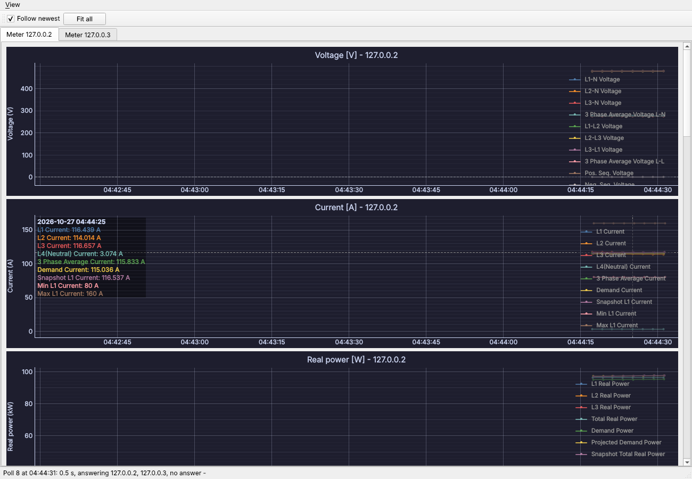
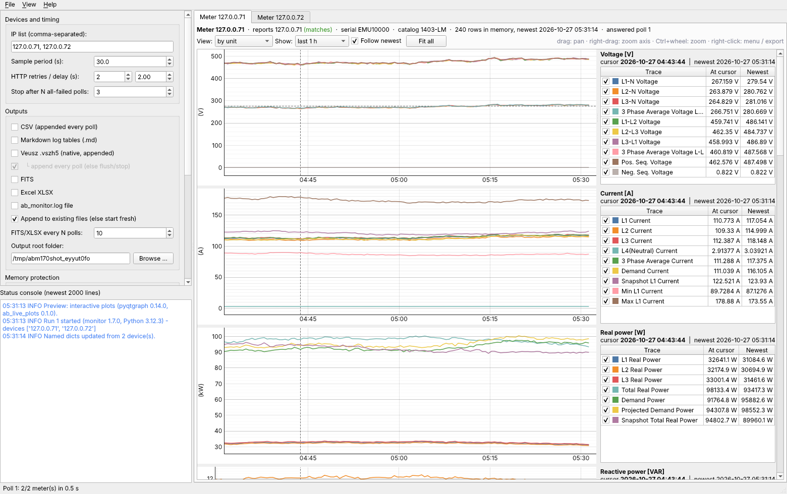

# Staged work: identical-looking meters, and interactive plots (toward 1.7.0)

**Status (2026‑10‑27, 06:00):** monitor **1.7.0** is built: the pyqtgraph GUI
is integrated (section 5) and tested on Python 3.12, 3.8 and 3.7. Still open:
**your check of the real meters** (section 3) — it decides whether anything
beyond the GUI is needed.

## 1. What was asked

1. The GUI plots of the two real meters (10.16.130.50, 10.16.130.54) look very
   similar or the same — triple‑check that data is not overwritten, reported
   wrongly or taken from the wrong IP. Meters may be read in parallel; the
   pages of one meter must be read one at a time.
2. Look at plotting libraries other than matplotlib that allow cursor read‑out,
   zoom and pan while the plots update (as in the power‑line RFI evaluator and
   the Narda envelope‑FFT GUI, which use pyqtgraph).
3. Stage the work; store it on TheGym.

## 2. Audit of the data path — result: no mix‑up in the code

| Stage | Keyed by | Evidence |
|---|---|---|
| Fetch | one thread per IP; inside it pages 0 → 10 one after another on one session (`poll_all_devices._poll_ip`) | test: at most **1** page in flight per meter, **2** meters in flight together, page order 0…10 |
| Parse | `parse_html_table(html, table, ip, page)` writes `_meta.source_ip` = the polled IP | — |
| Merge | `results["<ip>_<table>"]`; `update_named_dicts` files by `_meta.source_ip` | — |
| Store | `TIME_SERIES_STORE[ip][table]` | test: each meter's store holds only its own values and its own address |
| CSV / Markdown | one file per IP and table | test: values in the meter's own band, own IP octets |
| `.vszh5` / FITS / XLSX | one file per IP; datasets prefixed with the IP's last octet | test: same; no dataset of the other meter in a file |
| GUI preview | tab key `(ip, table, group)`; `render_preview_png(ip, …)` reads `TIME_SERIES_STORE[ip]` | test: `preview_series(ip)` in the meter's own band |
| Exporter / Grafana | label `ip` = polled IP | test: `snapshot()["by_unit"][ip]` in the meter's own band |

**Why no earlier test could have caught a mix‑up:** the emulator 0.0.1 served the
*same* values to every host (only phase‑shifted), so its two meters always
looked alike. Emulator **0.0.2** makes hosts distinguishable: values × (1 +
0.15 × host index), its own IP in page 1 (all four octets), its own serial
number. `tests/test_ip_separation.py` (4 checks) passes on Python 3.12.3 and
3.7.12, and all other suites still pass with the new emulator.

**New in monitor 1.6.5:** page 1 of a meter lists its own IP address. When all
four octets are there and differ from the address polled, a WARNING names both
(once per 10 min per meter), and the poll result lists `reported_ips`. A meter
answering for another meter is no longer silent.

## 3. What the real meters need to tell us — `ab_check_meters.py`

The code keeps the meters apart, so the similar plots come from the meters (or
the network), unless the real pages differ from the emulator's layout. Run
**on a PC that reaches the meters** (no files are written):

```
python ab_check_meters.py --ips 10.16.130.50,10.16.130.54 --samples 3 --interval 10
python ab_check_meters.py --csv-dir <the GUI's output folder>\csv
```

| Verdict | Meaning | Next step |
|---|---|---|
| SAME SOURCE | both addresses report the same IP or serial, or every reading is equal | network: duplicate IP, NAT/port forward or proxy; check the switch/ARP table |
| WRONG ADDRESS | a meter reports another address than the one polled | as above; the monitor 1.6.5 now warns about it |
| NEARLY EQUAL | readings differ by well under 1 % | one source read at slightly different times, or two meters on one circuit |
| DIFFERENT | readings differ | separate meters; the plots look alike because the loads are alike. Compare the numbers (the pyqtgraph crosshair shows them) |

The tool was verified with the emulator: two separate meters give DIFFERENT
(median 13 %); one meter behind both addresses gives SAME SOURCE + WRONG
ADDRESS; duplicated CSV files give SAME SOURCE; distinct CSV files give
DIFFERENT.

**Please send back:** the output of both commands (paste or `--markdown
check.md`), and if possible the HTML of page 0 and page 1 of one meter
(browser → Save page), so the emulator can match the real parameter names.

## 4. Plotting libraries for the live GUI

| Library | Live updates | Cursor read‑out / zoom / pan | Qt integration | Python 3.7 | Notes |
|---|---|---|---|---|---|
| matplotlib, Agg PNG in a QLabel (now) | re-renders a picture every poll | none in the tab (separate frozen window) | image only | yes | slow, static; the reason for the request |
| matplotlib QtAgg canvas | redraw of the whole figure | toolbar zoom/pan; read‑out only by custom code | widget | yes | slow for many points [6] |
| **pyqtgraph** | `setData()` in place, keeps zoom | built in: wheel/drag zoom, pan, auto‑range button; crosshair via `InfiniteLine` [3]; date axis [2] | native Qt widget, same binding (PySide6) | 0.12.4 (needs PySide6 ≤ 6.2.4, tested) | used by the RFI and Narda GUIs; fast for large arrays [1] |
| Veusz embedded | re-loads the document | Veusz UI | separate window / process [5] | yes | keep for publication-quality `.vszh5` output, not for live view |
| fastplotlib (GPU) | very fast | yes | Qt via wgpu | no (3.10+) | GPU rendering; newer, larger dependency [4] |
| Plotly in QtWebEngine | via JS | yes (hover, zoom) | web view | partly | heavy (Chromium); less suited to a light monitoring GUI |

**Recommendation:** pyqtgraph for the live tabs. It matches the other GUIs, is
fast, and is interactive while updating. Keep matplotlib only as a fallback
when pyqtgraph is missing. Keep Veusz (`.vszh5`) for reports.

### Prototype — `prototypes/pyqtgraph_live_preview.py` 0.0.1



* one tab per meter, one plot per **unit** (every parameter of that unit is a
  trace — the same grouping as the Grafana dashboard);
* crosshair with time and the value of every trace at the cursor; wheel/drag
  zoom, pan, "A" auto‑range, "Fit all"; time axes of one meter linked;
* "Follow newest" (any manual zoom switches it off, so an update never moves
  the view); clicking a legend entry hides/shows a trace; dark/light theme;
* polls through `abm.poll_cycle()` in a worker thread with every file output
  off — it writes nothing and shows exactly the monitor's store.

Run: `python prototypes/pyqtgraph_live_preview.py --demo` (emulated meters) or
`--ips 10.16.130.50,10.16.130.54 --interval 30` (real meters).

Tested offscreen: Python 3.12.3 + PySide6 6.12 + pyqtgraph 0.14.0: works;
Python 3.7.12 + PySide6 6.2.4 + pyqtgraph 0.12.4: works; Python 3.7.12 +
PySide6 6.5.3 (current 3.7 pin) + pyqtgraph 0.12.4: fails (`LabelItem __init__`
error — pyqtgraph < 0.13 with PySide6 ≥ 6.3).

## 5. Steps of 1.7.0 — done

| # | Step | Result |
|---|---|---|
| 1 | **Your check of the real meters** (section 3) | **still open** |
| 2 | Prototype integrated: `PREVIEW_BACKEND = "pyqtgraph"` (fallback `"matplotlib"`), one tab per meter, plot per unit; views *by table* and *overlay groups* in the tab's toolbar | done — `ab_live_plots.py` 0.1.0, monitor 1.7.0 |
| 3 | Legend in its own column | done — trace, value at cursor, newest value; crosshair shared by all plots of the meter |
| 4 | Memory: curves reused, no pixmaps, GUI soak | done — widget growth 0 (90 s, 3.12 and 3.7; 10 min, 3.12); two leaks found and fixed (pyqtgraph menus with PySide6 6.2; display arrays kept by `setData([], [])`) |
| 5 | Python 3.7 decision | **PySide6 6.2.4 + pyqtgraph 0.12.4** pinned (all suites pass); with 6.5.3 the GUI falls back to pictures by itself (verified) |
| 6 | Tests, docs, manual, kit | `tests/test_live_plots.py` (8 checks) passes on 3.12.3 (PySide6 6.12.0, 6.11.2), 3.8.20, 3.7.12; README, manual, kit 1.2.0 updated |



## 6. Files of this stage

| File | Version | What |
|---|---|---|
| `ab_power_meter_monitor.py` | 1.6.5 → **1.7.0** | reported‑IP check, `reported_ip()`, poll meta `reported_ips`; 1.7.0: interactive plots, `preview_groups()`, `meter_identity()` |
| `ab_live_plots.py` | **0.1.0** | the interactive meter tabs (pyqtgraph) |
| `tests/test_live_plots.py` | 0.0.1 | data and GUI checks of the plots |
| `tests/live_plot_memory_check.py` | 0.0.1 | plot memory / update time |
| `ab_check_meters.py` | 0.0.1 | live and CSV comparison of meters, verdicts |
| `tests/ab_meter_emulator.py` | 0.0.2 | distinguishable hosts, `--report-ip` |
| `tests/test_ip_separation.py` | 0.0.1 | serial pages / parallel meters, per‑meter data in every output |
| `tests/run_all_tests.py` | 0.0.3 | + `ip_separation` suite |
| `prototypes/pyqtgraph_live_preview.py` | 0.0.1 → 0.0.2 | prototype; now a thin viewer on `ab_live_plots` |
| `docs/plans/PLAN_1.7.0_pyqtgraph_and_meter_check.md` | 0.0.2 | this plan |

## References

| # | Reference (IEEE) |
|---|---|
| [1] | pyqtgraph developers, "pyqtgraph documentation," 2026. [Online]. Available: https://pyqtgraph.readthedocs.io/en/latest/ |
| [2] | pyqtgraph developers, "DateAxisItem," *pyqtgraph documentation*. [Online]. Available: https://pyqtgraph.readthedocs.io/en/latest/api_reference/graphicsItems/dateaxisitem.html |
| [3] | pyqtgraph developers, "InfiniteLine," *pyqtgraph documentation*. [Online]. Available: https://pyqtgraph.readthedocs.io/en/latest/api_reference/graphicsItems/infiniteline.html |
| [4] | fastplotlib developers, "fastplotlib," 2026. [Online]. Available: https://fastplotlib.org/ |
| [5] | J. Sanders, "Veusz — API (embedding)," *Veusz manual*. [Online]. Available: https://veusz.github.io/docs/manual/api.html |
| [6] | pyqtgraph developers, "pyqtgraph," *PyPI* (0.14.0 for Python ≥ 3.10; 0.12.4 last for 3.7). [Online]. Available: https://pypi.org/project/pyqtgraph/ |
